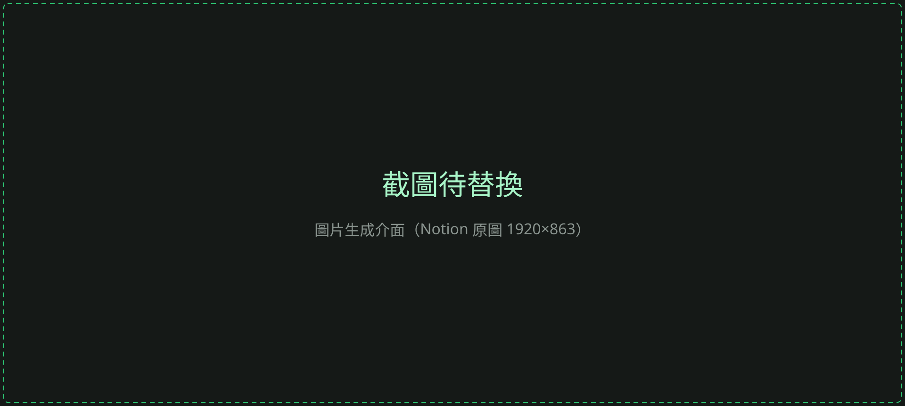
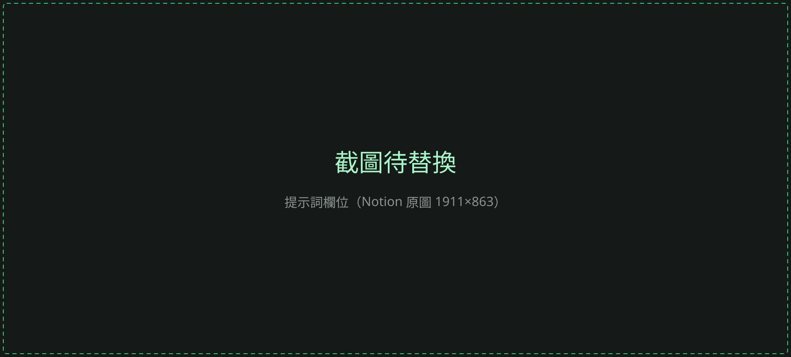

import { Aside, Steps } from '@astrojs/starlight/components';
import example1 from '../../../assets/image/basics-03-example.svg';

<Aside type="tip" title="你會學到">
進入圖片生成介面、選擇模型、寫出有效的提示詞，並送出第一張圖。
</Aside>

## 進入圖片生成介面

<Steps>

1. 進入 moonland.ai 網站後，點選左側選單的「生成」。

2. 在畫面下方切換到「圖片」。

3. 選擇模型。這篇以「FLUX.2」為例。

   

4. 確認生成模式和模型都選好後，就可以開始生成。

</Steps>

## 撰寫提示詞

在提示詞欄位輸入想生成的內容。描述得越完整，結果越接近你想要的畫面。

<Aside type="caution" title="提示詞至少要兩個詞">
提示詞是 AI 生成時最重要的依據。請至少用兩個以上的詞描述，並具體寫出希望畫面裡出現的物件。
</Aside>

如果不確定怎麼寫，可以點「提示詞自動修飾」，AI 會依照你選的模型改寫提示詞。詳細用法請看[提示詞助手](/image/prompt-assistant/)。

## 提示詞範例

| 提示詞 | 重點 |
| --- | --- |
| 一隻虎斑貓頭上戴著斗笠 | 主體（虎斑貓）＋ 配件（斗笠） |
| 一隻鸚鵡嘴裡叼著一根湯匙 | 主體（鸚鵡）＋ 動作（叼著湯匙） |
| 一位美麗的亞洲模特兒身穿禮服在走秀 | 主體 ＋ 服裝 ＋ 場景 |

  <figure><figcaption>虎斑貓戴斗笠</figcaption></figure>
  <figure><figcaption>鸚鵡叼湯匙</figcaption></figure>
  <figure><figcaption>模特兒走秀</figcaption></figure>

## 下一步

- [提示詞助手](/image/prompt-assistant/)：讓 AI 幫你把提示詞寫得更完整
- [圖片生成影片（i2v）](/video/image-to-video/)：把生成的圖片變成影片
